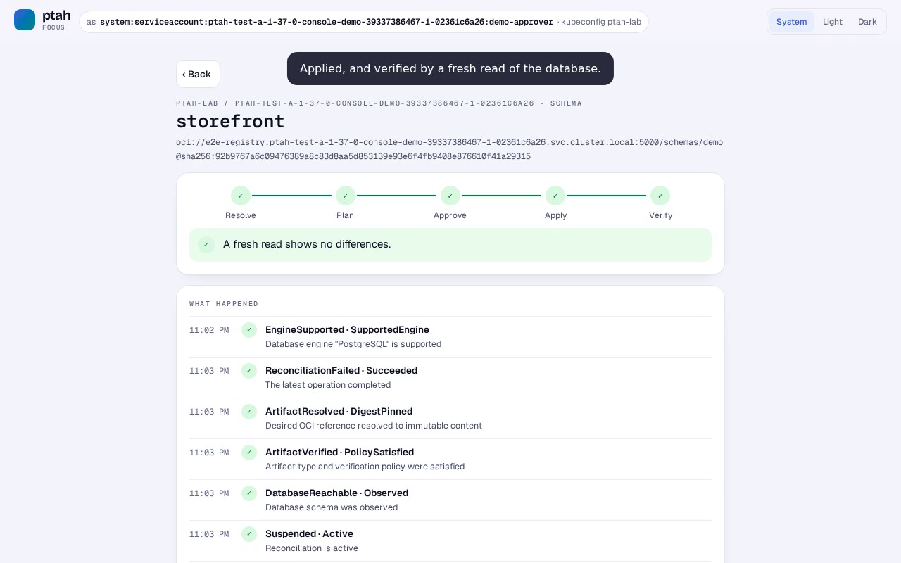

# Ptah Console

An optional web console for [Ptah Operator](https://github.com/stokaro/ptah-operator).

It answers the questions a person has when a schema change does not reach the
database on its own: what is happening, why, what is waiting for me, and which
action is valid next. A person can review the exact SQL of a plan and approve
that plan under their own Kubernetes identity; the operator's admission and
reconciliation stay the authority.

The console is not required to run the operator, and removing it does not
affect anything the operator does.

## Status

Under construction; there is no release yet. The plan and its steps are in
[stokaro/ptah-operator#587](https://github.com/stokaro/ptah-operator/issues/587),
and the architecture and security contract is
[stokaro/ptah-operator#588](https://github.com/stokaro/ptah-operator/issues/588).
[docs/design](docs/design/README.md) says what each screen reads, how the
console authenticates, and which operator versions it works with.

## Running it on your workstation

```bash
make build
./bin/ptah-console local --context <context> --namespace <namespace>
```

`local` acts with your own kubeconfig: every read and every decision goes to
the API server as you, so RBAC and the operator's admission judge you and
nobody else. It pins the context at start, listens on loopback only, and opens
the browser with a sign-in link that works once, for one minute; press Enter
in the terminal for a new one. `--no-open` prints the link instead,
`--read-only` refuses every change on the server, and audit lines go to
stderr.

The page has four views of the same resources:

- **Approver**: plans waiting for a decision. A plan shows what it changes and
  its exact SQL, read through the operator's integrity-checked plan reader and
  shown as plain text. Approving sends that plan, by UID and fingerprint, and
  nothing else; admission records who approved.
- **Developer**: each schema and migration as steps, with one sentence on
  where it stands and what happened.
- **On call**: what needs a person, the next step the operator supports, and
  the evidence Kubernetes still keeps: the Jobs the status names, their Pods,
  events and the end of their logs. A migration run the operator could not
  settle is acknowledged here.
- **Auditor**: who decided what and when, as admission recorded it, with a CSV
  export.

The page follows changes live. What a button offers depends on what RBAC says
you may do; the server decides.

A hosted mode, with personal Console accounts mapped to exact Kubernetes
identities through impersonation, follows.

## Demo

[](docs/demo/ptah-console-demo.mp4)

[The recording](docs/demo/ptah-console-demo.mp4) runs the scenarios of
[stokaro/ptah-operator#587](https://github.com/stokaro/ptah-operator/issues/587)
against a real operator, one person at a time, each signed in to a
`ptah-console local` of their own with a client certificate the cluster
issued:

- an outsider, a viewer and a SQL reviewer see what their RBAC lets them see,
  and are told what it does not;
- an author is not offered approval, and one sent anyway is forbidden;
- a lead who wrote the change is refused their own approval by the operator's
  four-eyes control;
- an approver approves a plan that drops a column and grants access, and
  follows it until the operator has applied it and verified it by a fresh read;
- a plan replaced while the approver decides is not approved, and the page
  says so;
- migrations 14 to 17 are approved without SQL the operator API does not carry;
- on call, a failed run shows the evidence Kubernetes still keeps and the end
  of its log;
- a MySQL run that stopped halfway is settled by an acknowledgment, not a
  retry;
- an API server that stops answering is reported, and decisions wait until it
  answers again;
- the auditor view shows who decided what, as admission recorded it.

The Acceptance workflow records it against the operator's own demonstration
lab, from the operator commit `go.mod` requires, cuts out the minutes the
operator spends applying, and checks every decision against the cluster rather
than the page. A run's `ptah-console-acceptance` artifact holds a fresh film.

## Building

```bash
make build                       # the binary with the web app
make test                        # Go unit tests
make test-envtest                # the API against a real API server
cd web && npm test               # the web app
cd web && npm run dev --workspace app   # then open /fixture.html: the screens on test data
```

## License

[MIT](LICENSE).
